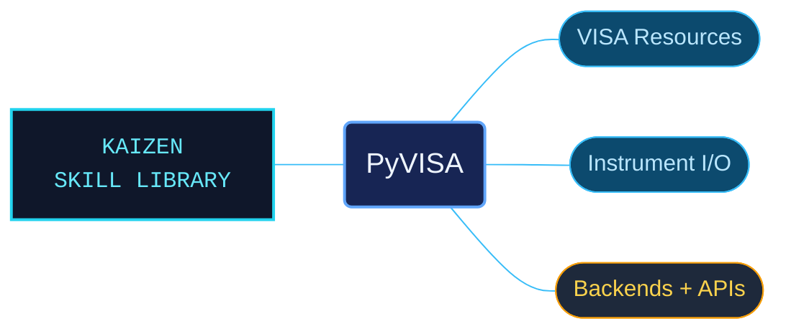

# PyVISA

PyVISA references for connecting to laboratory instruments and understanding the API beneath a measurement script. Guides, resource-class contracts and implementation excerpts are separated so an agent can move from connection setup to a specific I/O or backend question.

Use when working with PyVISA instrument control over VISA: ResourceManager, GPIB, USB, serial/RS-232, TCPIP/Ethernet, resource classes, read/write/query, ASCII/binary transfers, timeouts and termination, attributes/constants/status codes, events, the VISA shell, NI-VISA/pyvisa-py backends, low-level API or bundled implementation excerpts. Not for unrelated instrument libraries or general Python.

## What this skill helps with

| Task | Useful reference material |
| --- | --- |
| [Set up instrument communication](references/guides/guides-index.md) | Find backend setup, resource discovery and read/write/query workflows. |
| [Inspect resource management](references/resource-manager/resource-manager-and-resource-information-api-index.md) | Look up ResourceManager operations and resource information. |
| [Use resource-specific APIs](references/resources/resource-class-apis-api-index.md) | Check the interface and operations for the selected instrument resource class. |
| [Investigate lower-level behavior](references/visa-library/visa-library-base-low-level-api-index.md) | Follow VISA library contracts, constants and implementation routes. |

## The work behind the references

API reference prose and implementation excerpts are organized into separate, descriptive routes. The editorial pass clarified previously indistinguishable indexes and retained linked prerequisites, version context and source licensing around the technical material.

## Start here

Start with [SKILL.md](SKILL.md) and follow its context routes.

Match the documented resource class, backend and PyVISA version to the installation. Confirm instrument addressing, termination, timeout and transfer settings before applying an example. Hardware behavior depends on the connected instrument and its driver stack.

## Sources and license

Skill reference documentation is interpreted content for use in open source projects. Check against [official documentation sources](https://pyvisa.readthedocs.io/en/latest/) when dealing with defects or issues that may come up from interpreting this skill's references.

Licensed under **Apache-2.0**; see [LICENSE](LICENSE). Part of the [Agent Kaizen](https://github.com/LevyBytes/agent-kaizen) skill library.
